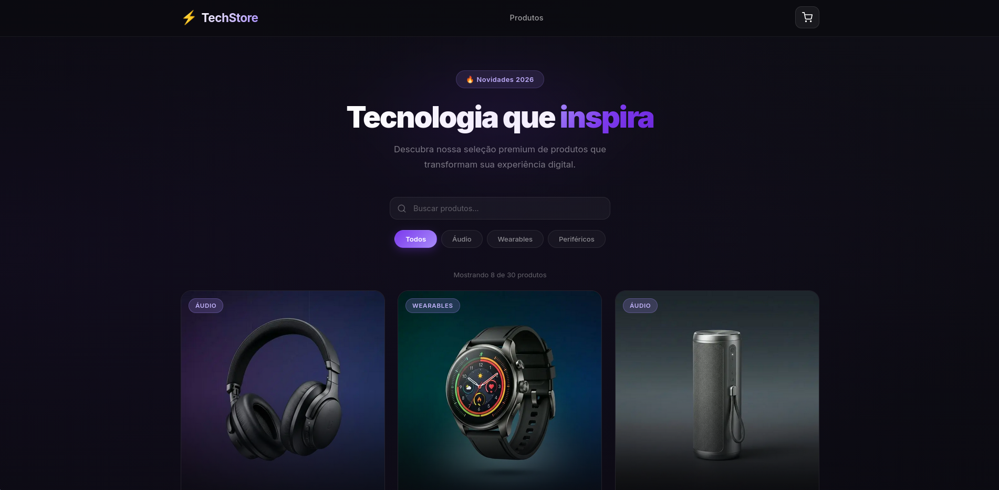
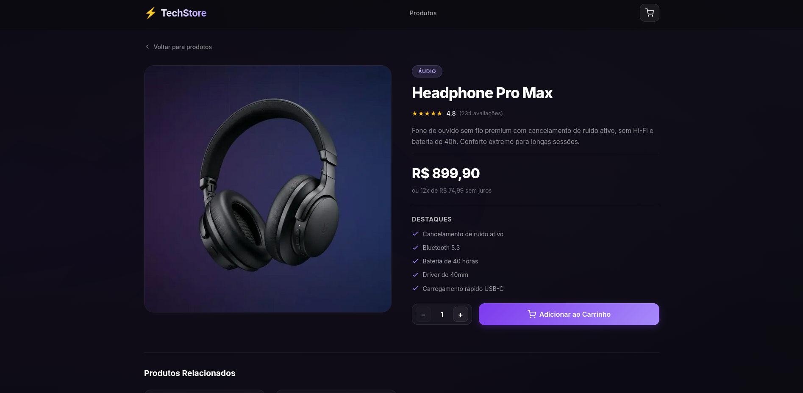
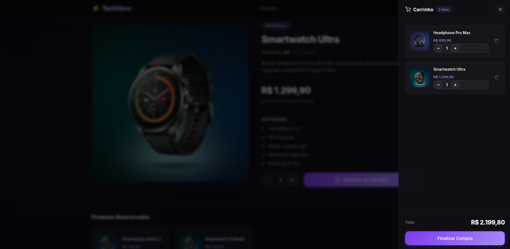

# ⚡ TechStore

> Loja virtual moderna de produtos de tecnologia, construída com **Next.js 16** e **React 19** — tema escuro, arquitetura de Server Components e **catálogo com scroll infinito**.

<p align="left">
  
  
  
  
</p>

TechStore é uma vitrine de e-commerce pensada para ser **visualmente elegante** e, ao mesmo tempo, uma referência de **arquitetura moderna do App Router**: renderização no servidor, ilhas cliente mínimas, cache com invalidação por tag e carregamento incremental de produtos conforme o usuário rola a página.

**Demo:** [infostoretech.vercel.app](https://infostoretech.vercel.app) · **No portfólio:** [iagorivelo.vercel.app/projects/tech-store](https://iagorivelo.vercel.app/projects/tech-store)

---

## 📸 Demonstração

| Home — catálogo com scroll infinito | Página de produto |
|---|---|
|  |  |

| Produtos relacionados | Carrinho lateral |
|---|---|
|  |  |

---

## ✨ Funcionalidades

- **Catálogo com scroll infinito** — novos produtos são carregados automaticamente conforme você rola a página, com _skeletons_ de carregamento suaves e um sentinela que dispara o fetch antes de chegar ao fim (sem "pulo").
- **Busca e filtro por categoria no servidor** — a busca cobre **todo** o catálogo, não apenas o que já foi carregado no cliente.
- **Carrinho de compras** lateral (drawer) com controle de quantidade, remoção, total automático e persistência em `localStorage`.
- **Páginas de detalhe** com features, parcelamento, seletor de quantidade e produtos relacionados.
- **Navegação SPA** com prefetching e transições instantâneas.
- **Acessibilidade** — `aria-*`, navegação por teclado e respeito a `prefers-reduced-motion`.
- **SEO** — metadados, Open Graph e `sitemap.xml` gerado automaticamente.

---

## 🧰 Stack

| Tecnologia | Função |
|---|---|
| [Next.js 16](https://nextjs.org/) (App Router) | Framework React com renderização híbrida e roteamento por arquivos |
| [React 19](https://react.dev/) | Server Components + Client Components (ilhas) |
| **Server Actions** | Paginação incremental — devolve `ProductCard`s já renderizados no servidor |
| **Cache Components** (`use cache`) | Cache da camada de dados com `cacheLife` e invalidação por `cacheTag` |
| [CSS Modules](https://github.com/css-modules/css-modules) | Estilo com escopo local por componente |
| [React Context API](https://react.dev/learn/passing-data-deeply-with-context) | Estado global do carrinho |
| [next/image](https://nextjs.org/docs/app/api-reference/components/image) | Otimização automática de imagens |
| [Intersection Observer](https://developer.mozilla.org/pt-BR/docs/Web/API/Intersection_Observer_API) | Gatilho do scroll infinito |
| [Inter](https://fonts.google.com/specimen/Inter) via `next/font` | Tipografia self-hosted, sem layout shift |

---

## 🏗️ Arquitetura em destaque

**Scroll infinito com Server Actions.** A primeira página do catálogo é renderizada no servidor e entregue no HTML inicial (ótimo LCP/SEO). As páginas seguintes chegam sob demanda pela Server Action `loadProducts`, que também renderiza os cards **no servidor** — o JavaScript do card nunca vai para o bundle do cliente. A ilha cliente `ProductExplorer` apenas orquestra o estado, observa um sentinela via `IntersectionObserver` e cuida dos estados de carregamento.

```
Home (Server Component)
  └─ renderiza a 1ª página → <ProductCard/> (RSC)
       └─ ProductExplorer (Client Island)
            ├─ IntersectionObserver → loadProducts() [Server Action]
            │                              └─ getProductsPage() [use cache]
            └─ busca/filtro (debounce) → reinicia a lista via Server Action
```

**Filtro no servidor.** `getProductsPage({ offset, limit, category, query })` aplica busca e categoria antes de paginar, então os resultados são consistentes em todo o catálogo. É uma função `use cache`, pronta para trocar o array local por um banco/API real sem mudar os componentes.

---

## 📁 Estrutura do projeto

```
src/
├── app/                          # App Router: páginas, layouts e rotas
│   ├── layout.js                 # Layout raiz (providers, header, drawer, fontes, metadata)
│   ├── page.js                   # Home — renderiza a 1ª página do catálogo
│   ├── actions.js                # Server Action de paginação (loadProducts)
│   ├── loading.js / error.js     # Estados de rota (streaming e erro)
│   ├── not-found.js              # 404 global
│   ├── sitemap.js                # Geração automática do sitemap.xml
│   └── produto/[slug]/           # Página de detalhe (rota dinâmica)
│
├── components/
│   ├── ui/                       # Genéricos: Button, Container, QuantitySelector, StarRating…
│   ├── product/                  # ProductCard, ProductExplorer (scroll infinito), ProductSkeleton…
│   ├── cart/                     # CartDrawer
│   └── layout/                   # Header
│
├── context/
│   └── CartContext.js            # Estado do carrinho (Context API + localStorage)
│
├── data/
│   └── products.js               # Catálogo (30 produtos)
│
├── lib/
│   ├── products.js               # Acesso a dados cacheado (use cache) + paginação
│   └── pagination.js             # PAGE_SIZE compartilhado (server + client)
│
└── utils/
    └── format.js                 # Formatação de preços (R$)
```

> 📖 Quer entender o projeto por dentro, arquivo por arquivo? Veja o **[GUIA-DO-PROJETO.md](GUIA-DO-PROJETO.md)**.

---

## 🚀 Como rodar

**Pré-requisitos:** [Node.js 18.18+](https://nodejs.org/) e npm.

```bash
# 1. Clone o repositório
git clone https://github.com/iagorivelo/tech-store.git
cd tech-store

# 2. Instale as dependências
npm install

# 3. Rode em modo de desenvolvimento
npm run dev
```

Acesse **[http://localhost:3000](http://localhost:3000)**.

### Build de produção

```bash
npm run build   # gera o build otimizado
npm run start   # sobe o servidor de produção
```

### Scripts disponíveis

| Script | Descrição |
|---|---|
| `npm run dev` | Servidor de desenvolvimento (Turbopack) |
| `npm run build` | Build de produção |
| `npm run start` | Servidor de produção |
| `npm run lint` | Análise estática com ESLint |

---

## 💡 Decisões técnicas

- **Server Actions para paginação** em vez de uma Route Handler + fetch manual: menos código, cards renderizados no servidor e integração nativa com o cache.
- **CSS Modules em vez de Tailwind** — cada componente carrega seu `.module.css` com escopo local, sem conflito de classes.
- **Context API para o carrinho** — nativo, suficiente para o escopo, com funções memoizadas (`useCallback`/`useMemo`) para evitar re-renders.
- **Latência simulada de ~500ms** na Server Action para deixar o skeleton de carregamento visível na demo — deve ser removida ao plugar uma fonte de dados real (marcada com comentário no código).

---

## 📝 Licença

Distribuído sob a licença **MIT**. Sinta-se livre para usar como referência de estudo.
